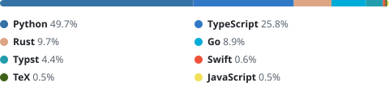

## Hi, I'm Jan 👋

Python developer from Poland, working on backends with **FastAPI, Django and AWS**.
In my own time I build handy terminal tools, mobile apps for iOS, experiment with AI workflows and try out new programming languages.

### 🔨 Some of the things I've built

|                                                                                    |                                                                                         |
| ---------------------------------------------------------------------------------- | --------------------------------------------------------------------------------------- |
| 🎬 **[quick-repertoire](https://github.com/kodzonko/quick-repertoire)**             | Cinema City, Helios & Multikino showtimes in your terminal, with TMDB ratings · Rust    |
| 🎧 **[anyaudiobook](https://github.com/kodzonko/anyaudiobook)**                     | Turn any ebook into an audiobook with Edge TTS · Python                                 |
| 🔐 **[SDEx communicator](https://github.com/kodzonko/SDEx-encrypted-communicator)** | Mobile messenger with SDEx encryption and BLAKE3 hashing (bachelor thesis) · TypeScript |

### 🧰 Stack

<picture>
  <source media="(prefers-color-scheme: dark)" srcset="./github-languages-dark.svg">
  
</picture>
